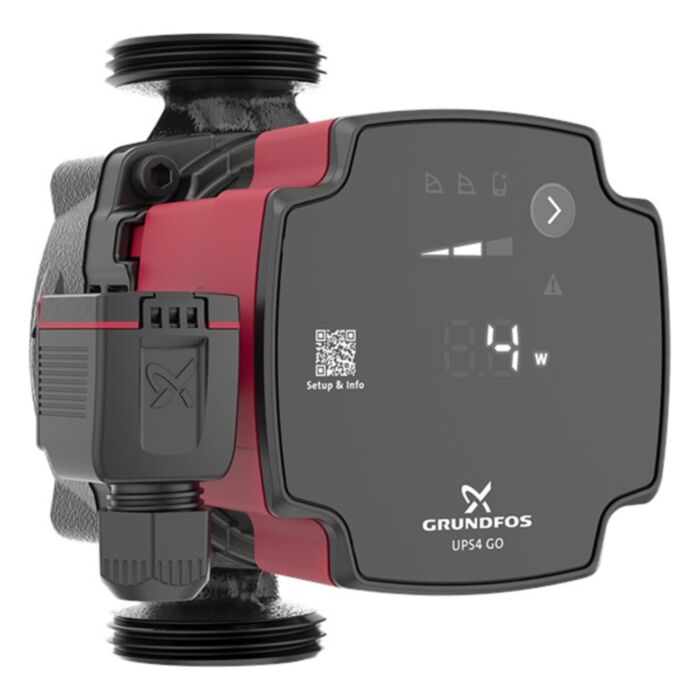

# Grundfos Alpha2 Go — Intégration HACS pour Home Assistant

Intégration locale (Bluetooth LE, protocole GENIbus) pour le circulateur **Grundfos Alpha2 Go**. Lecture seule : la pompe n'est jamais pilotée.

## Entités

| Entité | Type | Source |
|---|---|---|
| Joignable | `binary_sensor` (connectivity) | Annonces BLE reçues — **aucune connexion ouverte** |
| En marche | `binary_sensor` (running) | Puissance ≥ 3 W ou vitesse ≥ 100 tr/min |
| Puissance | `sensor` (W) | GENIbus |
| Vitesse | `sensor` (tr/min) | GENIbus |
| Tension, Courant | `sensor` (désactivés par défaut) | GENIbus |

## Prérequis

- Home Assistant **2024.12** ou plus récent, avec Bluetooth (adaptateur local ou proxy ESPHome)
- La pompe n'accepte qu'**une connexion BLE à la fois** : fermez l'application Grundfos GO

## Installation via HACS

1. HACS → ⋮ → **Dépôts personnalisés**
2. Ajoutez `https://github.com/tifcar07/grundfos_alpha2go2` — catégorie **Integration**
3. Installez **Grundfos Alpha2 Go**, puis redémarrez Home Assistant
4. Paramètres → Appareils et services → **Ajouter une intégration** → Grundfos Alpha2 Go

La pompe est normalement découverte automatiquement. Sinon, choisissez « Saisir manuellement » et entrez son adresse MAC (`AA:BB:CC:DD:EE:FF`).

## Fonctionnement

- **Joignable** : écoute passive des annonces BLE via la pile Bluetooth de Home Assistant.
- **Lecture GENIbus** toutes les 120 s : connexion courte (`bleak-retry-connector`), requête « power », réponse par notification, puis **déconnexion systématique** (`finally`). Aucune connexion n'est laissée ouverte entre deux lectures.
- Les échecs de lecture sont journalisés une seule fois par le coordinateur (pas de flood de logs).

Trames GENIbus reprises du composant ESPHome `alpha3` (service `FE5D`, caractéristique `859cffd1-036e-432a-aa28-1a0085b87ba9`).

## Dépannage

Activez les logs de debug :

```yaml
logger:
  logs:
    custom_components.grundfos_alpha2go: debug
```

| Message | Signification |
|---|---|
| `Trame power : …` | Lecture réussie |
| `type de réponse non reconnu […] — trame : …` | La pompe répond dans un autre format : ouvrez une issue avec la trame |
| `Réponse incomplète (0 octets)` | Pas de réponse : couplage Bluetooth probablement nécessaire |
| `pompe non visible par le Bluetooth` | Hors de portée de l'adaptateur / du proxy |

## Historique

- **2.0.0** — Réécriture : connexion courte par lecture (corrige la fuite de descripteurs et le flood « disconnected »), lecture GENIbus réelle, capteurs Joignable / En marche / Puissance / Vitesse, correction de la saisie manuelle.
- **1.x** — Lecture du nom, modèle et firmware uniquement.

## Licence et remerciements

- Licence : GPL-3.0 (voir `LICENSE`)
- Protocole : [ESPHome alpha3](https://esphome.io/components/sensor/alpha3.html), [AlphaDecoder](https://github.com/JsBergbau/AlphaDecoder), binding openHAB GrundfosAlpha
